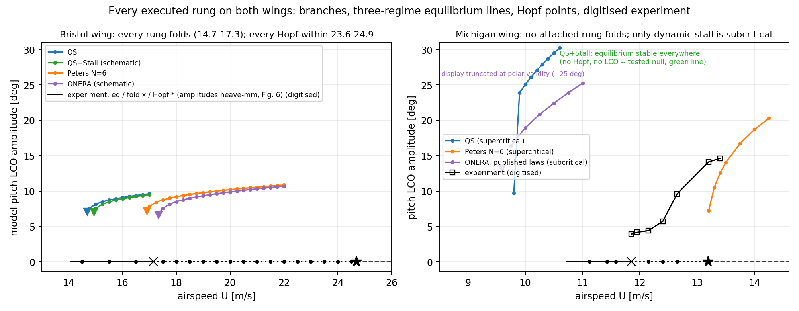

# Multifidelity-LCO-Prediction

**What is the cheapest aerodynamic model that still predicts where a subcritical wing loses stability?**

Code for the MSc research paper *Selecting Aerodynamic Model Fidelity for Subcritical Aeroelastic Stability Boundaries* (P. Ritthidetch, University of Bristol, 2026; supervisor Dr F. Healy).

In a subcritical aeroelastic system, large-amplitude limit-cycle oscillations (LCO) can persist *below* the linear flutter speed, down to a fold speed. The fold, not flutter, is the real stability boundary. This repository couples four low-order aerodynamic models to a nonlinear 2-DOF pitch–plunge typical section and checks which one is the minimum needed to reproduce the measured fold on two experimental wing rigs.



## What's inside

**Aerodynamic models** (`src/mflco/aero/`)

| Model | Physics added | Cost per query |
|---|---|---|
| Quasi-steady (QS) | Attached flow, no wake memory | 0.6 s |
| Peters finite-state, N = 6 | Unsteady wake (inflow states) | 1.3 s |
| QS + static stall | Static polar lookup about trim | 0.6 s |
| ONERA dynamic stall | Dynamic separation | 28.3 s |

**Structural model** (`src/mflco/model/`): 2-DOF pitch–plunge typical section with a nonlinear pitch spring, integrated with LSODA (rtol 1e-7, atol 1e-9).

**Fold detector** (`src/mflco/model/fold_detector.py`): brute-force continuation. It steps airspeed down in 0.25 m/s increments from the previous orbit, then bisects to 0.05 m/s where the LCO collapses.

**Experimental rigs**

| Rig | Section | Dominant nonlinearity | Measured flutter | Measured fold |
|---|---|---|---|---|
| Bristol (Tartaruga et al., 2019) | NACA 0015, 0° trim | Structural (hardening spring) | ~24 m/s | ~16 m/s |
| Michigan (García Pérez et al., 2024) | NACA 0020, 10° trim | Aerodynamic (stall) | 13.19 m/s | 11.85 m/s |

## Results

**Bristol rig: structurally dominant.** Every model produces a fold, so the fold comes from the spring.

| Model | Flutter [m/s] (err) | Fold [m/s] (err) |
|---|---|---|
| QS | 23.64 (−1.5%) | 14.69 (−8.2%) |
| Peters N = 6 | 23.98 (−0.08%) | 16.91 (+5.7%) |
| QS + static stall | 24.07 (+0.29%) | 14.94 (−6.6%) |
| ONERA | 24.92 (+3.8%) | 17.34 (+8.4%) |

Adding the unsteady wake moves the fold by 2.2 m/s. Adding dynamic stall moves it a further 2.6%. **Minimum sufficient model: Peters finite-state.**

**Michigan rig: aerodynamically dominant.** Attached-flow models find no usable fold.

| Model | Flutter [m/s] (err) | Fold [m/s] | Boundary error vs measured fold | Cost/query |
|---|---|---|---|---|
| QS | 9.665 (−26.7%) | none | −18.4% | 0.6 s |
| Peters N = 6 | 13.148 (−0.32%) | none | +10.95% | 1.3 s |
| QS + static stall | none | none | no instability predicted | 0.6 s |
| ONERA | 10.875 (−17.55%) | 9.594 (−19.0%) | −19.0% | 28.3 s |

Static stall collapses the lift slope at 10° trim and removes the instability entirely. Untuned ONERA (NACA 0012 coefficients) restores the subcritical structure and recovers 1.281 of the measured 1.34 m/s bistable window (96%). **Minimum sufficient model: ONERA dynamic stall.**

**Main finding:** flutter accuracy does not transfer to boundary accuracy. Peters matches Michigan flutter to 0.32% but misses the true boundary by 10.95%. The paper proposes classifying a system by its dominant nonlinearity before committing to a model class.

**CFD ceiling check** (`CFD/SU2/Euler`): steady Euler in SU2 at the Michigan trim gives Cl = 1.357 against a measured 0.757 (+79%), at roughly 10,000× the cost of the low-order models. It was used to bound the comparison and excluded from it.

## Verification

- Reproduces Barton's AeroelasticCBC.jl subcritical model: Hopf point within 0.08%, fold within 0.6% (`examples/stage0_barton_*.py`).
- 78 automated tests (`tests/`).

## Install and run

Requires Python 3.10+.

```bash
git clone https://github.com/mondididi/Multifidelity-LCO-Prediction.git
cd Multifidelity-LCO-Prediction
pip install -e ".[dev]"
pytest                     # 78 tests
```

Regenerate the paper's figures and results matrix into `results/`:

```bash
PYTHONPATH=src python examples/build_paper_figures.py
```

The `examples/stageN_*.py` scripts follow the study's stages: verification (0), linear eigenvalue sweeps (1), LCO continuation (2), static stall (3), ONERA (4) and full-rig runs (5). `docs/` has notes on the aerodynamic and structural models and the rig parameters.

## Repository layout

```
src/mflco/      aero models, structural model, fold detector, rig parameters
tests/          pytest suite (78 tests)
examples/       stage scripts and figure builders
results/        figures (F1–F8), results matrix (T1), digitised experimental data
docs/           model and validation notes
CFD/SU2/Euler   SU2 steady-Euler ceiling cases
```

## Limitations

- ONERA coefficients are NACA 0012 values applied unchanged to the NACA 0020 Michigan section, the likely source of the −19% error.
- The Bristol static polar is schematic, not measured.
- The 0.023 m/s Michigan bistable window from Peters is below the 0.05 m/s detector resolution.
- Time-marching cannot find unstable orbits, so unstable branches are basin-boundary estimates.

Future work: NACA 0020 ONERA coefficients, RANS to price separation, and a UVLM rung.

## Citation

Ritthidetch, P. (2026). *Selecting Aerodynamic Model Fidelity for Subcritical Aeroelastic Stability Boundaries.* MSc Research Paper No. 2526RP046, School of Civil, Aerospace and Design Engineering, University of Bristol.

## License

MIT (as declared in `pyproject.toml`).